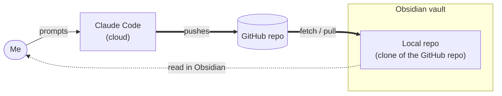

# how_i_claude
Documenting my approaches to using and deploying Claude

## How it fits together

Claude Code does the work and pushes it to GitHub. I read the results in a local Obsidian vault. See the [full workflow](workflows/obsidian-claude-github-workflow.md) for the detailed diagram and trust boundaries.

## Contents

- [Obsidian + Claude Code + GitHub workflow](workflows/obsidian-claude-github-workflow.md): how cloud Claude Code, GitHub and a local Obsidian vault fit together, with a diagram of the layers and trust boundaries
