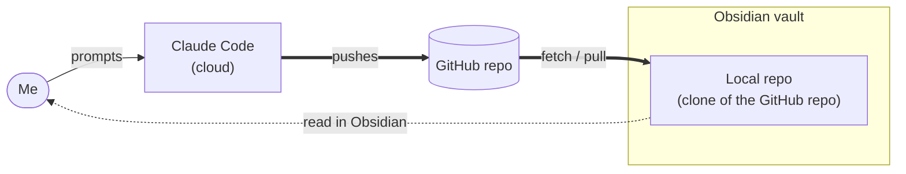
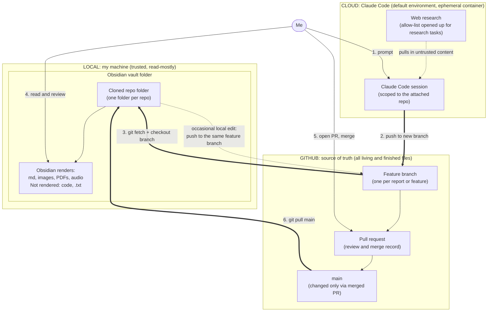

# Obsidian + Claude Code + GitHub workflow

How I use Claude Code (in the cloud), GitHub, and a local Obsidian vault together. Claude Code does the work and GitHub holds the results. Obsidian is where I read them.

## Overview

What lives where, and how information moves between the pieces.

- **Claude Code** receives my prompts and pushes its work to the GitHub repo.
- **GitHub repo** receives from Claude Code. (My occasional local edits and PR merges are covered in the detailed diagram below.)
- **Local repo** receives from GitHub and lives inside the Obsidian vault.
- **Me:** I prompt Claude Code and read the results in Obsidian.

## Detailed diagram

Solid thick arrows are git transfers. Thin arrows are things I do. The dotted arrows are the exceptions: web content flowing into Claude Code, and my occasional local edits.

## The three layers

| Layer | What lives there | Role |
|---|---|---|
| **Cloud** | Claude Code in a default cloud environment | Does the work: research, writing, code. The container is ephemeral, so anything worth keeping must be pushed. |
| **GitHub** | Every living or finished file | The only durable store. Each report or feature gets its own branch. |
| **Local** | An Obsidian vault containing a clone of the repo | A reading surface. Obsidian renders the vault folder, so a checked-out branch is immediately browsable. |

## Flow

1. I prompt Claude Code. Each new report, code feature, etc. gets its own branch.
2. Claude Code commits and pushes the branch to GitHub.
3. Locally, I fetch and check out that branch in the repo clone inside the vault.
4. I read the output in Obsidian.
5. I merge through a pull request. This is deliberate: the PR is the record I can go back to later.
6. I pull `main` locally to stay in sync.

Local edits are rare. When I make one, I push it to the feature branch and not to `main`. I try never to change `main` directly.

## Trust boundaries

- **Cloud → GitHub:** Claude Code can push only to repositories attached to the session, and the instructions for a session name the branch it should use. Nothing reaches `main` without a PR.
- **Web → Cloud:** the default environment allows outbound requests, and I open the allow-list wider for research tasks. Everything fetched from the web is untrusted input to Claude Code. A malicious page can try to steer the session (prompt injection), so the damage it can do is limited by what the session can reach: only the attached repo, and only through a branch.
- **GitHub → Local:** I check out branches that Claude Code produced. Obsidian only displays Markdown, images, PDFs and audio, so this layer is a place to read output, and code and `.txt` files are not rendered at all.
- **Local → GitHub:** my own edits take the same route as Claude's, through a feature branch and a PR.

The main control in every layer is the same: the blast radius is one repo, one branch at a time, and a human merge sits between any change and `main`.

## Obsidian limits

| Renders in Obsidian | Does not render |
|---|---|
| Markdown, images, PDFs (sometimes), audio | Code files, `.txt` |

For anything in the second column, I open the file in an editor or read it on GitHub.
